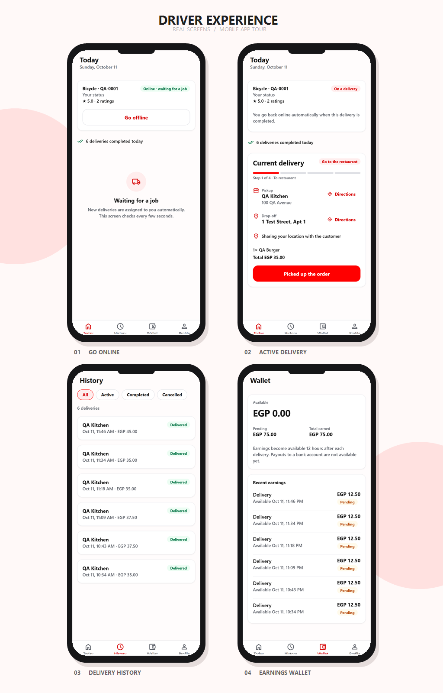

<p align="center">
  
  &nbsp;&nbsp;
  
</p>

<h1 align="center">Delivery Plus Driver App</h1>

<p align="center">Go online, receive deliveries automatically and take each order from the restaurant to the customer.</p>

<p align="center">
  <strong>DELIVERY PLUS</strong>
  &nbsp; × &nbsp;
  <a href="https://expo.dev"></a>
</p>

<p align="center">
  <a href="https://github.com/Delivery-Plus0/delivery-plus-driver-app"></a>
  
  
  
</p>

Built with **Expo 57 / React Native 0.86 / Expo Router / TypeScript**, on the same foundation as the [customer app](https://github.com/Delivery-Plus0/delivery-plus-customer-app): API client, session handling, `useResource` cache and polling, UI kit, lint and test setup. It talks only to the Delivery Plus API gateway; the backend lives in [Delivery-Plus0/delivery-plus](https://github.com/Delivery-Plus0/delivery-plus) (issue #99).

## App gallery

<p align="center">
  <a href="./identity/mobile-screens.png"></a>
</p>

Four real screens from the running app, presented in rounded phone frames. Captured at phone width from the web build with seeded QA data.

## Features (MVP)

| Area | What works | Backend contract |
| --- | --- | --- |
| Navigation | Tabs: **Today** (status, current job or what to do next), **History**, **Wallet**, **Profile** (email, vehicle, sign out). History and Wallet say "coming soon" until their backend exists (#142, #145/#146); they never show invented trips or money | — |
| Account | Sign up as a driver; sign in (DRIVER accounts only; other roles are refused before a session is stored) | `POST /api/auth/register`, `/login` |
| Vehicle | First-use vehicle registration | `GET /api/drivers/me` (404 → register), `POST /api/drivers/register` |
| Availability | Go online / offline; "On a delivery" while busy (the backend frees the driver on completion) | `POST /api/drivers/me/online`, `/me/offline` |
| Current job | Step progress (to restaurant → picked up → on the way → delivered), pickup (restaurant, address) and drop-off (address, notes) each with a **Directions** hand-off to the maps app, items and total; polled every 5 s while on shift. Offline, the Today tab explains how to get jobs | `GET /api/deliveries/me/current` (204 → waiting) |
| Actions | One button for the next step: picked up → start delivery → mark as delivered. Each step is one-way, so an in-app dialog asks first (retry-safe on the server) | `POST /api/deliveries/:id/pickup|start|complete` |
| Location | While on a delivery (assigned → in transit) the app sends its position every 10 s, foreground only; the card shows whether sharing works or permission is off | `POST /api/tracking/location` |

Deliveries are assigned by the backend (automatic dispatch), so there is no "accept" step in this MVP. Not yet built: background location, push notifications, earnings.

## Getting started

Requirements: Node.js 22 and the backend dev stack (gateway on `http://localhost:3000`).

```bash
cp .env.example .env.local     # EXPO_PUBLIC_API_BASE_URL=http://localhost:3000
npm ci
npm run web                    # or: npm start  (Expo Go / emulator)
```

Demo driver (after `npm run seed` in the backend): `driver@example.com` / `password123`. On the E2E stack (`:3100`): `qa.driver@delivery-plus.test`.

Optional, development only: `EXPO_PUBLIC_FIXED_LOCATION=30.0444,31.2357` makes the app report that position instead of asking the device (useful on web; the E2E build sets it). Leave it unset in release builds.

## Project structure

```text
src/
├── app/            Expo Router screens: (auth) welcome·sign-in·sign-up, (app)/(tabs) home = Today (vehicle, status, current job), history, wallet, profile
├── components/     UI kit shared with the customer app (cards, buttons, form inputs, alerts, state views) + dialog.tsx (in-app confirmation, driver-only until the shared kit #155)
├── services/       API client (api.ts), session, auth, drivers (profile, online/offline), deliveries (current, actions), location + tracking
├── state/          driver.ts: useMyDriver, useCurrentDelivery and the actions that update the cache
├── hooks/          useResource (cache, polling, in-flight dedupe), useLocationSharing, theme hooks
├── utils/          driver-status (labels, toggle rules, next action, confirmations), delivery-steps (job progress), maps (directions link), location-sharing (send loop, rules), formatting, login errors (unit-tested)
└── test/           Test setup
```

## Testing

| Level | Command |
| --- | --- |
| Typecheck | `npm run typecheck` |
| Lint (zero warnings) | `npm run lint` |
| Unit tests (vitest) | `npm test` |
| UI / E2E (Maestro, against the backend's isolated E2E stack) | `npm run e2e:smoke -- --build`, `npm run e2e:all -- --headless` |

See [e2e/README.md](e2e/README.md) for the suites, test data and how to run them.

## CI, branches and contributing

CI runs typecheck, lint, unit tests and a web export; the E2E workflow runs the Maestro smoke suite on every PR (everything nightly); the Security workflow runs `npm audit` and a Trivy filesystem/secret scan. `dev` is the default branch, `testing` and `main` follow the backend's model. See [CONTRIBUTING.md](CONTRIBUTING.md), [SECURITY.md](SECURITY.md) and [CODE_OF_CONDUCT.md](CODE_OF_CONDUCT.md).

## License

See [LICENSE](LICENSE).
