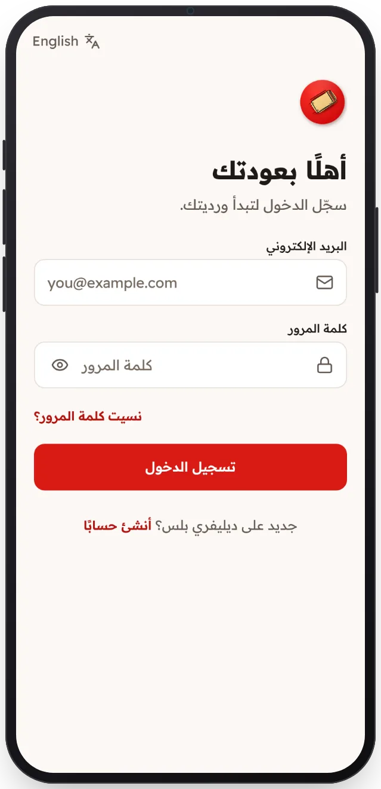

<!-- Generated from the app's web build (screens in docs/screens); regenerate rather than edit by hand. -->

[تطبيق السائق](../../../README.md) › [الشاشات](../README.md) › 2 من 12 · [English](../en/02-sign-in.md)

<h1 align="center">تسجيل الدخول</h1>

حسابات السائقين فقط تدخل من هنا.

<a href="01-welcome.md">→ السابق</a> &nbsp;·&nbsp; <b>2 / 12</b> &nbsp;·&nbsp; <a href="03-application.md">التالي ←</a>

