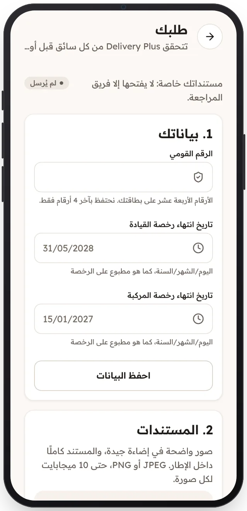

<!-- Generated from the app's web build (screens in docs/screens); regenerate rather than edit by hand. -->

[تطبيق السائق](../../../README.md) › [الشاشات](../README.md) › 3 من 12 · [English](../en/03-application.md)

<h1 align="center">طلب الانضمام</h1>

الرقم القومي وتواريخ انتهاء الرخص وخمس صور مستندات، مع ما ينقص.

<a href="02-sign-in.md">→ السابق</a> &nbsp;·&nbsp; <b>3 / 12</b> &nbsp;·&nbsp; <a href="04-under-review.md">التالي ←</a>

