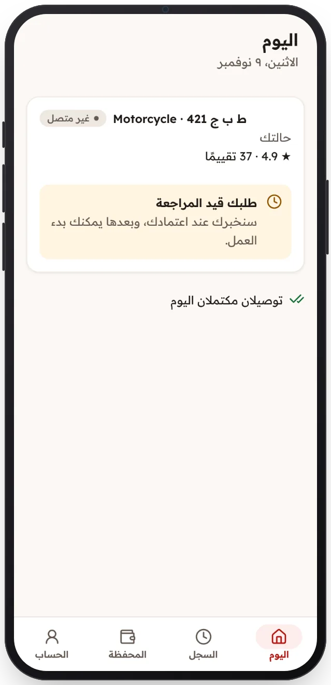

<!-- Generated from the app's web build (screens in docs/screens); regenerate rather than edit by hand. -->

[تطبيق السائق](../../../README.md) › [الشاشات](../README.md) › 4 من 12 · [English](../en/04-under-review.md)

<h1 align="center">قيد المراجعة</h1>

يراجع فريقنا الطلب، ولا يمكن بدء العمل قبل الموافقة.

<a href="03-application.md">→ السابق</a> &nbsp;·&nbsp; <b>4 / 12</b> &nbsp;·&nbsp; <a href="05-offline.md">التالي ←</a>

