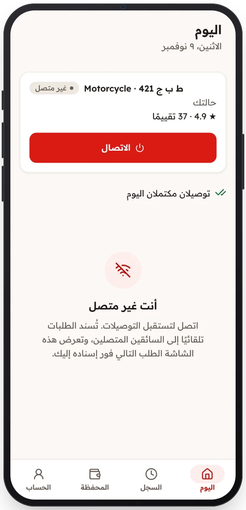

<!-- Generated from the app's web build (screens in docs/screens); regenerate rather than edit by hand. -->

[تطبيق السائق](../../../README.md) › [الشاشات](../README.md) › 5 من 12 · [English](../en/05-offline.md)

<h1 align="center">جاهز للعمل</h1>

ابدأ العمل لتصلك الطلبات.

<a href="04-under-review.md">→ السابق</a> &nbsp;·&nbsp; <b>5 / 12</b> &nbsp;·&nbsp; <a href="06-online.md">التالي ←</a>

