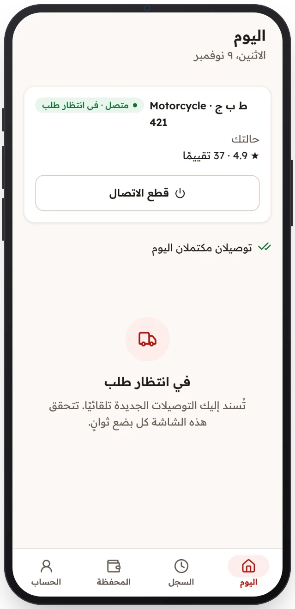

<!-- Generated from the app's web build (screens in docs/screens); regenerate rather than edit by hand. -->

[تطبيق السائق](../../../README.md) › [الشاشات](../README.md) › 6 من 12 · [English](../en/06-online.md)

<h1 align="center">متاح</h1>

في انتظار الطلب التالي، ويُشارك موقعك أثناء العمل فقط.

<a href="05-offline.md">→ السابق</a> &nbsp;·&nbsp; <b>6 / 12</b> &nbsp;·&nbsp; <a href="07-job-pickup.md">التالي ←</a>

