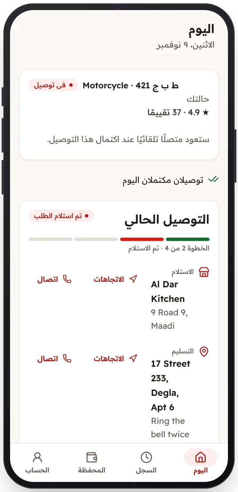

<!-- Generated from the app's web build (screens in docs/screens); regenerate rather than edit by hand. -->

[تطبيق السائق](../../../README.md) › [الشاشات](../README.md) › 8 من 12 · [English](../en/08-job-drop-off.md)

<h1 align="center">في الطريق إلى العميل</h1>

الخطوة التالية، وزر للاتصال بالعميل.

<a href="07-job-pickup.md">→ السابق</a> &nbsp;·&nbsp; <b>8 / 12</b> &nbsp;·&nbsp; <a href="09-licence-warning.md">التالي ←</a>

