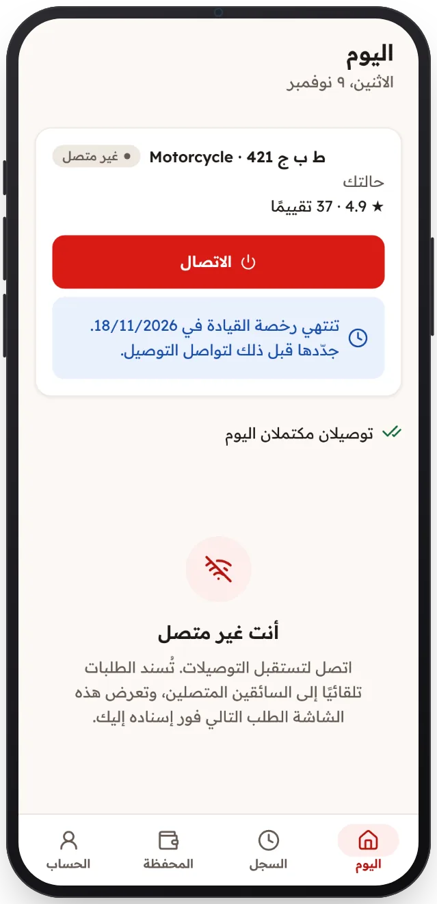

<!-- Generated from the app's web build (screens in docs/screens); regenerate rather than edit by hand. -->

[تطبيق السائق](../../../README.md) › [الشاشات](../README.md) › 9 من 12 · [English](../en/09-licence-warning.md)

<h1 align="center">الرخصة على وشك الانتهاء</h1>

تذكير قبل انتهاء الرخصة ليجددها السائق في الوقت المناسب.

<a href="08-job-drop-off.md">→ السابق</a> &nbsp;·&nbsp; <b>9 / 12</b> &nbsp;·&nbsp; <a href="10-history.md">التالي ←</a>

