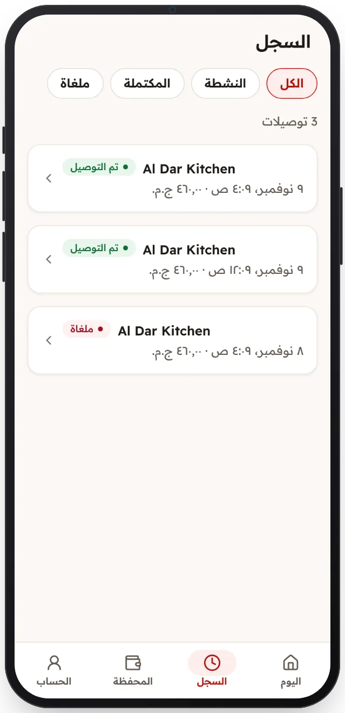

<!-- Generated from the app's web build (screens in docs/screens); regenerate rather than edit by hand. -->

[تطبيق السائق](../../../README.md) › [الشاشات](../README.md) › 10 من 12 · [English](../en/10-history.md)

<h1 align="center">السجل</h1>

التوصيلات السابقة مع عوامل التصفية.

<a href="09-licence-warning.md">→ السابق</a> &nbsp;·&nbsp; <b>10 / 12</b> &nbsp;·&nbsp; <a href="11-wallet.md">التالي ←</a>

