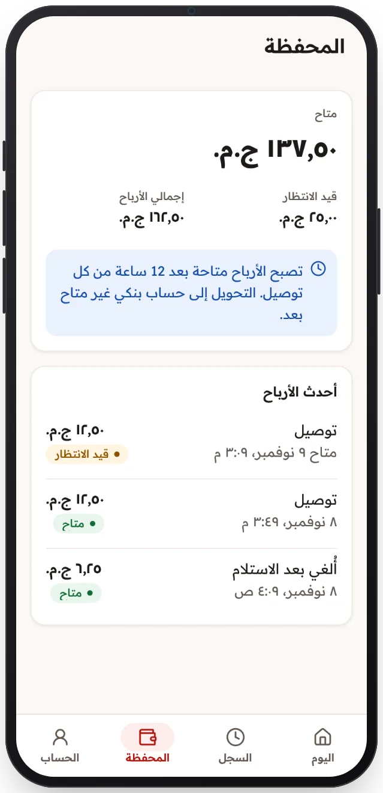

<!-- Generated from the app's web build (screens in docs/screens); regenerate rather than edit by hand. -->

[تطبيق السائق](../../../README.md) › [الشاشات](../README.md) › 11 من 12 · [English](../en/11-wallet.md)

<h1 align="center">المحفظة</h1>

الأرباح المعلّقة والمتاحة، بندًا بندًا.

<a href="10-history.md">→ السابق</a> &nbsp;·&nbsp; <b>11 / 12</b> &nbsp;·&nbsp; <a href="12-profile.md">التالي ←</a>

