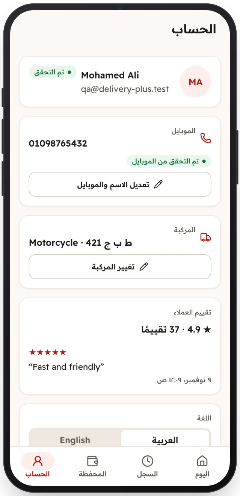

<!-- Generated from the app's web build (screens in docs/screens); regenerate rather than edit by hand. -->

[تطبيق السائق](../../../README.md) › [الشاشات](../README.md) › 12 من 12 · [English](../en/12-profile.md)

<h1 align="center">الملف الشخصي</h1>

التقييم وحالة المراجعة والمركبة والهاتف واللغة.

<a href="11-wallet.md">→ السابق</a> &nbsp;·&nbsp; <b>12 / 12</b> &nbsp;·&nbsp; التالي ←

