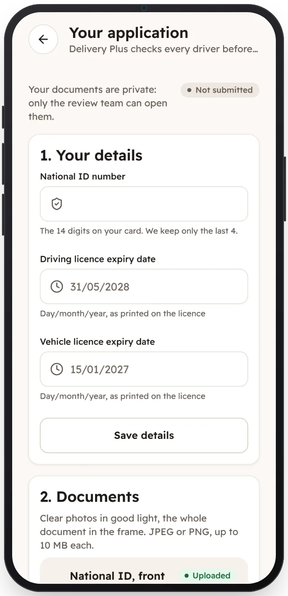

<!-- Generated from the app's web build (screens in docs/screens); regenerate rather than edit by hand. -->
[Driver app](../../../README.md) › [Screens](../README.md) › 3 of 12 · [العربية](../ar/03-application.md)

<h1 align="center">Your application</h1>

National ID, licence expiry dates and five document photos, with what is still needed.

<a href="02-sign-in.md">← Previous</a> &nbsp;·&nbsp; <b>3 / 12</b> &nbsp;·&nbsp; <a href="04-under-review.md">Next →</a>

