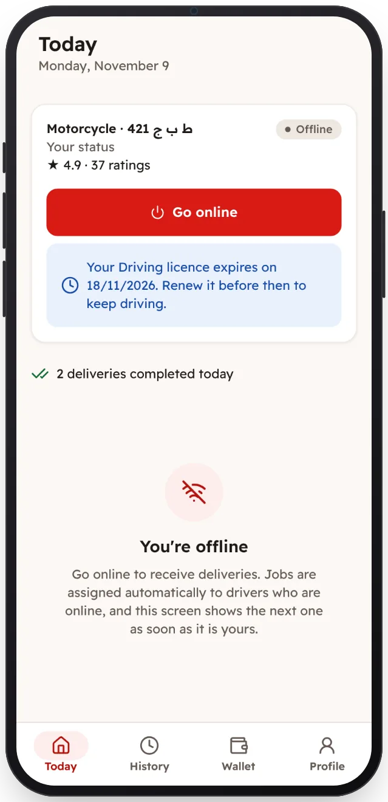

<!-- Generated from the app's web build (screens in docs/screens); regenerate rather than edit by hand. -->
[Driver app](../../../README.md) › [Screens](../README.md) › 9 of 12 · [العربية](../ar/09-licence-warning.md)

<h1 align="center">Licence expiring soon</h1>

A reminder before a licence expires, so the driver can renew it in time.

<a href="08-job-drop-off.md">← Previous</a> &nbsp;·&nbsp; <b>9 / 12</b> &nbsp;·&nbsp; <a href="10-history.md">Next →</a>

